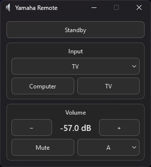

# Yamaha-Remote-Control

Small PySide6 desktop remote for Yamaha receivers/amplifiers using the Yamaha Extended Control API.



## Installation

Run `YamahaRemote.pyw` from a writable folder. On first launch it creates `YamahaRemote.json` and prompts you to fill in the missing connection settings; you can also copy `YamahaRemote.example.json` to `YamahaRemote.json` before starting.

Local settings, diagnostic logs, and temporary JSON files are ignored by Git. When updating an older Git checkout, back up `YamahaRemote.json` before pulling this change and restore it afterward if Git removes it. Do not put credentials in the example file.

## Windows

```powershell
py -m pip install "PySide6>=6.8"
```

Run `YamahaRemote.pyw`.

For Windows login startup, add `--start-in-tray` to your shortcut target, for example:

```text
"C:\Path\To\pythonw.exe" "C:\Remotes\YamahaRemote.pyw" --start-in-tray
```

This starts hidden only when `SystemTray` and `CloseToTray` are both `true` and a tray is available; otherwise the window opens normally. Launching the app again still brings the existing window forward.

## macOS

```bash
python3 -m pip install "PySide6>=6.8"
python3 YamahaRemote.pyw
```

## Configuration

```json
{
  "Host": "192.168.1.100",
  "DarkMode": true,
  "Mica": true,
  "VolumeDb": true,
  "VolumeDbAtZero": -97.0,
  "VolumeDbStepSize": 0.5,
  "GlobalShortcuts": {"VolumeUp": [], "VolumeDown": [], "Mute": []},
  "DiagnosticsEnabled": false,
  "SortByName": false,
  "Inputs": {},
  "SystemTray": false,
  "CloseToTray": false
}
```

- `Host` — IP address or hostname of the Yamaha device.
- `DarkMode` — Requests Qt’s native dark (`true`) or light (`false`) appearance independently of the desktop theme. Requires PySide6 6.8 or newer.
- `Mica` — Windows-only Mica background. Ignored on macOS.
- `VolumeDb` — display volume in dB instead of the API volume value.
- `VolumeDbAtZero` — dB value corresponding to volume `0`. Required when `VolumeDb` is `true`.
- `VolumeDbStepSize` — dB change corresponding to one volume step. Required when `VolumeDb` is `true` and must be greater than `0`.
- `GlobalShortcuts` — Windows global bindings for `VolumeUp`, `VolumeDown`, and `Mute`. Empty lists disable them; focused bindings remain independent under `Shortcuts`.
- `Shortcuts` — focused action-to-key lists; see the keyboard shortcut section below.
- `DiagnosticsEnabled` — `false` by default. Set to `true` to append unexpected errors and crash diagnostics to `YamahaRemote-crash.log` beside the script. Logs contain the app version, exception types, and stack locations; exception messages, source lines, request data, and local variable values are omitted. If the log cannot be opened or written, the app continues without logging.
- `SortByName` — `false` (default) keeps favorites and dropdown entries in JSON insertion order; `true` sorts them alphabetically by `NameOverride`, falling back to `Name`, ignoring case.
- `DropdownAnimationWorkaround` — use a live 200 ms input-dropdown animation to avoid dropdown flicker on Windows (enabled by default on Windows). Set to `false` for the standard Qt dropdown; disabled system animations remain disabled.
- `Inputs` — settings for the inputs discovered from the Yamaha device.
  - `Name` — name reported by the Yamaha device. This is updated automatically.
  - `NameOverride` — optional replacement name shown in the dropdown and on favorite buttons. Long closed labels end with an ellipsis; favorite buttons keep equal widths.
  - `Hidden` — hide the input from the dropdown menu. Hidden inputs can still be favorites.
  - `Favorite` — show a button for the input directly in the remote.
  - `Removed` — maintained automatically; confirmed missing entries disappear from dropdowns and favorites, then return with their preferences when rediscovered.
- `SystemTray` — show a system tray icon when the desktop supports it. If unavailable, the app runs as an ordinary window.
- `CloseToTray` — clicking the window close button hides the app to the tray instead of exiting. If no tray is available, closing the window exits normally.

YamahaRemote automatically adds newly discovered inputs to `Inputs` with default settings. Existing `NameOverride`, `Hidden`, and `Favorite` values are preserved. Existing entries keep their JSON positions; newly discovered entries append in device discovery order. Dropdowns exclude `Hidden` and `Removed` entries; favorites exclude `Removed` entries. Name sorting affects display only and does not reorder the JSON file. Availability is refreshed while the device is on and the window visible; missing entries need a second successful check after five seconds, and the UI resizes without restarting.

When `VolumeDb` is enabled, the displayed dB value is calculated using:

`dB = VolumeDbAtZero + (volume × VolumeDbStepSize)`

For example:

`VolumeDbAtZero = -97.0`  
`VolumeDbStepSize = 0.5`

means that a volume value of `100` is displayed as `-47.0 dB`.

The app automatically restarts when `YamahaRemote.json` changes.

Launching Yamaha Remote again restores its existing window, including from the system tray.

Regular status polling pauses while the window is hidden or minimized and refreshes immediately when restored, unless Windows global volume hotkeys are enabled and their hook is installed, or a local TV remote is connected through IPC. In that case, the existing polling timer continues while hidden, including in standby or offline, so external power changes and reconnections can be detected. Active requests finish normally; configuration file watching remains enabled.


## Volume hotkeys

Edit `Shortcuts` to replace focused keyboard bindings; each action accepts a list such as `["Ctrl+Alt+Up", "F8"]`. Missing actions are added with defaults on startup, while `[]` or `""` disables that action's focused shortcut; button tooltips show the configured bindings.

Keyboard names use [Qt portable shortcut notation](https://doc.qt.io/qt-6/qkeysequence.html#detailed-description). See the example JSON for all actions and [key-name examples and behavior](IMPLEMENTATION.md#configurable-focused-shortcuts) for media/numpad keys.

Mouse button and wheel names can also be added to the same `Shortcuts` lists; see the shared [mouse binding reference](https://github.com/cnieuweboer/Sony-Remote-Control/blob/main/KEYBOARD_SHORTCUTS.md#mouse-bindings). Mouse bindings are focused-only.

By default, volume keys control the amplifier while this window is focused. To use them globally on Windows, set `GlobalShortcuts` to `{"VolumeUp": ["Volume Up"], "VolumeDown": ["Volume Down"], "Mute": ["Volume Mute"]}`; `[]` or `""` disables each global action. Existing enabled global media keys are migrated automatically.

## More information

- [Implementation details](IMPLEMENTATION.md) — hotkeys, IPC, and calibration coordination.
- [Release history](CHANGELOG.md) — versions and changes.

## Third-party code

YamahaRemote includes Windows Mica integration code inspired by
[win32mica](https://github.com/marticliment/win32mica), licensed under the MIT License.

The relevant license text is included in `THIRD_PARTY_LICENSES.txt`.

### Cached state report

Run `python YamahaRemote.pyw --dump-state` while the remote is running to save a timestamped diagnostic JSON beside the script (or in the app-data diagnostics folder if needed). This leaves the window as it is and makes no device queries; the result message gives the file path. Credentials and text-entry contents are omitted, but review reports before sharing.

Use `--dump-state-full` instead to include the last successful decoded response for each polling request, with its timestamp and age. It still makes no fresh queries; full reports may include device/network identifiers and app inventories, so review them before sharing.

Both reports also include session-only polling counters for successes, empty inventories, failures and recoveries; these reset when the remote restarts.

### Default volume per input

- Set `DefaultVolume` per input:
  - Integer, e.g. `96`
  - dB string, e.g. `"-51.5 dB"`
  - `""` = inherit `GlobalDefaultVolume`
  - `false` = disable for that input
- An empty `GlobalDefaultVolume` makes no volume change.
- Apply defaults once after a confirmed input change while powered on.
- Set `StartupDefaultVolume: true` to also apply after a confirmed standby-to-on transition.
- Detection is not instantaneous; audio may briefly play at the previous volume. This is not a safety limiter.
- Optional retry delay: append `+seconds`, e.g. `"-50.5 dB +2"` or `"93 +2"`.
  - Apply immediately.
  - After the delay, fetch fresh status and reapply once if needed.
  - Cancel the retry on state/connection changes, calibration, suspended polling, or remote volume/mute commands.
